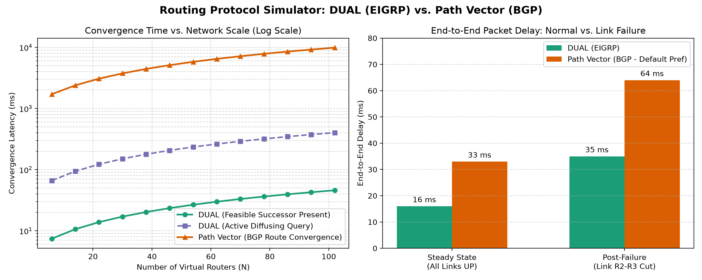

# Routing Protocol Simulator with Performance Analysis

> **A comparative simulation of Diffusing Update Algorithm (DUAL / EIGRP) and Path Vector (BGP) routing over a virtual multi-router topology, with convergence and performance benchmarking.**

🌐 **Live Interactive Website:** [https://neerajroy24.github.io/routing-protocol-simulator/](https://neerajroy24.github.io/routing-protocol-simulator/)

## Overview
Traditional routing simulators compare basic Distance Vector (RIP) and Link-State (OSPF) algorithms. This project implements and benchmarks two advanced production routing paradigms:
1. **DUAL (Diffusing Update Algorithm - EIGRP):** Uses a composite bandwidth + delay metric and maintains loop-free backup paths (**Feasible Successors**) satisfying the Feasibility Condition ($RD < FD$) for sub-second convergence.
2. **Path Vector Routing (BGP):** Operates across Autonomous Systems (AS), using explicit `AS_PATH` attributes for loop prevention and policy attributes (`LOCAL_PREF`) for path selection.

## Features
- **Virtual Multi-Router Topology:** Models a 6-router mesh network with varying link capacities (10 Mbps legacy links, 100 Mbps backup links, and 1000 Mbps fiber backbone).
- **Link Failure & Reconvergence Engine:** Simulates a core link cut (`R2 <-> R3`) and measures path switchover behavior, end-to-end latency, and bottleneck bandwidth.
- **Automated Performance Plotting:** Generates comparative charts (`performance_analysis.png`) evaluating convergence latency scaling ($N = 6 \dots 100$ routers) and packet delay.

## Interactive Web Dashboard

A complete interactive visual dashboard is included in the project:
- **Interactive SVG Topology:** Click any network link or button to simulate a physical cut and watch both DUAL and BGP re-route in real-time.
- **Side-by-Side Path Visualizer:** Real-time metrics, Feasible Successor analysis, and AS-PATH trace.
- **Animated Packet Ping:** Watch packets travel hop-by-hop along the active path.
- **Live Scalability & Delay Charts:** Interactive Chart.js charts for convergence latency and delay comparison.
- **Theoretical Formula Lab:** Interactive composite metric calculator.

```bash
# Launch interactive web dashboard locally:
python serve.py
# Or simply double-click: open_website.bat
```

## Installation & Usage

```bash
# 1. Clone the repository
git clone https://github.com/NeerajRoy24/routing-protocol-simulator.git
cd routing-protocol-simulator

# 2. Install dependencies
pip install -r requirements.txt

# 3. Run the simulator and generate benchmark plots
python simulator.py
```

## Performance Benchmark Results

